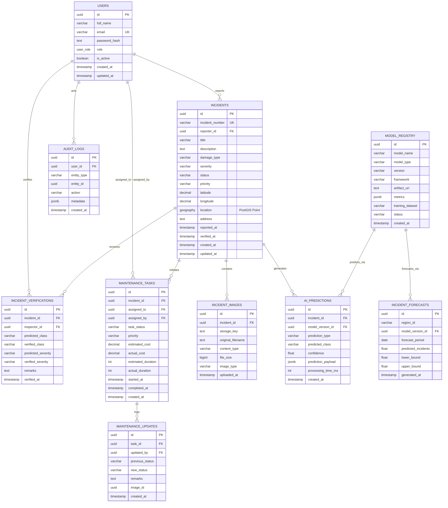

# CivicPulse AI — Database Schema & Entity-Relationship (ER) Documentation

This document describes the complete relational and geospatial database schema for CivicPulse AI, implemented using PostgreSQL 16, PostGIS 3.4, and Prisma ORM.

---

## 1. Entity-Relationship Diagram (ERD)



---

## 2. Spatial Indexing & Geospatial Capabilities

### PostGIS Point Geometry
The `incidents` table contains a spatial column `location` of type `geography(Point, 4326)`:
```sql
ALTER TABLE incidents 
ADD COLUMN IF NOT EXISTS location geography(Point, 4326) 
GENERATED ALWAYS AS (ST_SetSRID(ST_MakePoint(longitude::float8, latitude::float8), 4326)::geography) STORED;
```

### Spatial Indexing (GiST)
```sql
CREATE INDEX IF NOT EXISTS idx_incidents_location_gist 
ON incidents USING GIST (location);
```

### Nearby Incident Queries
Find all incidents within a 500-meter radius of a coordinate:
```sql
SELECT id, incident_number, title, ST_Distance(location, ST_SetSRID(ST_MakePoint(77.2090, 28.6139), 4326)::geography) AS distance_meters
FROM incidents
WHERE ST_DWithin(location, ST_SetSRID(ST_MakePoint(77.2090, 28.6139), 4326)::geography, 500)
ORDER BY distance_meters ASC;
```

---

## 3. Database Security & Concurrency
- Primary keys are generated as UUIDv4 using `gen_random_uuid()`.
- Password hashes are stored as Argon2id/bcrypt strings in `users.password_hash`.
- Cascade deletion is enforced for child artifacts (`incident_images`, `ai_predictions`) when an incident is deleted.
- Verification and audit records preserve history without destructive updates.
