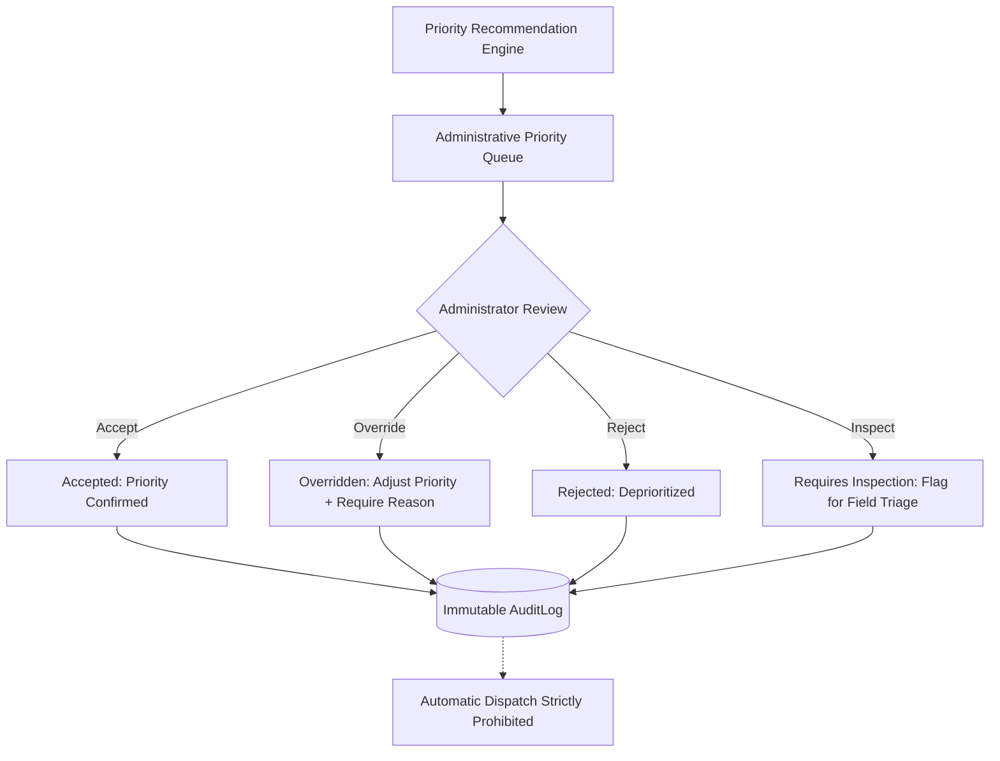

# CivicPulse AI — Phase 3, Stage 3: Explainable Maintenance Priority Engine

**Status:** Completed & Verified  
**Date:** November 2026  
**Module:** Predictive Maintenance Intelligence — Maintenance Priority  
**Services:** `services/api` (Express / TypeScript / PostGIS), `services/ml` (Python / Scikit-Learn Scaffolding), `apps/web` (Next.js 16)

---

## Executive Summary

Phase 3 Stage 3 delivers an **explainable, multi-factor maintenance priority recommendation engine** that ranks road-damage incidents for municipal administrative review. 

Crucially, this system is an **administrative decision-support system, NOT an autonomous dispatch engine**. Field repair crews are never automatically dispatched. All priority recommendations are fully transparent, explainable, and reviewable by authorized administrators, who may accept, override (with mandatory logged reasons), reject, or flag incidents for field re-inspection.

The system strictly adheres to core ethical MLOps standards:
1. **No Artificial Predictions:** Heuristic priority recommendations are explicitly labeled as decision-support heuristics, never presented as statistical or machine-learning predictions.
2. **Supervised ML Gating:** Because the operational database contains only 2 maintenance tasks and 0 completed repairs, supervised priority classification is strictly locked with status `DATA_INSUFFICIENT` ($N < 50$ required).
3. **Immutable Audit Provenance:** Overrides and review actions are recorded immutably in `AuditLog` preserving the original recommendation, the reviewer identity, timestamp, and justification.

---

## 1. Geographic Data Governance Discrepancy Resolution

### 1.1 The Discrepancy

In Phase 3 Stage 1 (`docs/PHASE_3_DATA_READINESS.md`), it was preliminarily reported that all 66 incident records were situated in Delhi NCR (latitudes $\approx 28.6^\circ\text{N}$, longitudes $\approx 77.2^\circ\text{E}$). However, the Stage 5 spatial audit and Stage 3 spatial coordinate census revealed a major geographic data split:

- **Bengaluru Metropolitan Area (`BENGALURU_METRO`):** **58 incidents** ($87.9\%$)
  - **Dense Outer Ring Road (ORR) Corridor:** 57 incidents clustered tightly along the Marathahalli / Bellandur arterial corridor ($12.9716^\circ\text{N}, 77.5946^\circ\text{E}$).
  - **South Corridor Outlier (`INC-357677-895`):** 1 incident located on Bellandur Flyover ($12.9260^\circ\text{N}, 77.6762^\circ\text{E}$), situated **$10,017\text{ meters}$** southeast of the central ORR cluster.
- **National Capital Territory of Delhi (`DELHI_NCR`):** **8 incidents** ($12.1\%$)
  - Concentrated across Connaught Place, Barakhamba Flyover, Sansad Marg, and Transitway Zone 4 ($28.6139^\circ\text{N} - 28.6412^\circ\text{N}, 77.2045^\circ\text{E} - 77.2250^\circ\text{E}$).
- **Ambiguous / Unassigned:** **0 incidents** ($0.0\%$).

### 1.2 Administrative Classification Boundaries

To eliminate hardcoded city labels and derive geographic classifications from validated geography, CivicPulse AI implements bounding-box spatial classifiers (`services/api/src/modules/maintenance-priority/geo-classifier.ts`):

```typescript
// BENGALURU_METRO: Lat [12.75, 13.25], Lon [77.40, 77.85]
// DELHI_NCR:       Lat [28.35, 28.90], Lon [76.85, 77.45]
```

All 66 database records fall unequivocally within these municipal boundaries. The straight-line Haversine distance separating the two regions is **$1,740\text{ km}$**. Stage 1 documentation has been updated to reflect this multi-region reality without altering original coordinates.

---

## 2. Feature Inventory & Taxonomy

Every feature used in priority evaluation is categorized by source entity, empirical nature, missingness, and triage suitability:

| Field | Source Entity | Taxonomy | Missingness | Priority Engine Role |
| :--- | :--- | :--- | :--- | :--- |
| `verifiedSeverity` | `IncidentVerification` | **Human Ground Truth** | 90.9% (6/66 verified) | Primary severity score (100 pts for critical, 75 for high, 50 for medium, 25 for low). Authoritative. |
| `provisionalSeverity` | Stage 2 Rule Engine | **Deterministic Heuristic** | 0% (Evaluated on-demand) | Secondary severity fallback (discounted to 90 for critical, 70 for high). Explicitly labeled as heuristic. |
| `damageType` | `Incident` | Visual Classification | 0% (66/66) | Drives safety hazard assessment (e.g. pothole vs surface crack). |
| `normalizedArea` | Stage 2 Feature Extractor | Derived Optical Proxy | 0% (Pixel ratio) | Extent scoring. Pixel area ratio on image plane; not physical square meters. |
| `defectCount` | Stage 2 Feature Extractor | Optical Observation | 0% (66/66) | Multi-defect compounding factor for damage extent. |
| `reportedAt` | `Incident` | Timestamp Observation | 0% (66/66) | Incident age scoring ($>14$ days backlog escalation). |
| `nearbyCountIn500m` | PostGIS `ST_DWithin` | Spatial Metric | 0% (66/66) | Local spatial concentration / cluster density scoring. |
| `address` / `title` | `Incident` | Metadata Observation | 4.5% (3/66 null address) | Arterial corridor safety detection (flyovers, ring roads, transitways). |
| `cvConfidence` | `AiPrediction` | Model Certainty | 0% (66/66) | Evidence quality scoring. **Model confidence is NOT severity.** |
| `images` | `IncidentImage` | Sensor Record | 0% (66/66) | Evidence completeness verification. |

---

## 3. Priority Scoring Formula & Normalization

The priority engine combines six normalized criteria into a composite score:

$$\text{Priority Score} = \sum_{i=1}^{6} w_i \times F_i$$

All factors $F_i$ are normalized to the range $[0, 100]$ prior to weighting.

### 3.1 Factor Normalization Specifications

1. **Severity Factor ($F_1$, Weight $w_1 = 0.30$):**
   - *Inspector Verified:* `critical` $\to 100$, `high` $\to 75$, `medium` $\to 50$, `low` $\to 25$.
   - *Provisional Heuristic:* `CRITICAL` $\to 90$, `HIGH` $\to 70$, `MODERATE` $\to 45$, `LOW` $\to 20$.
   - *Unverified / Missing:* $35$ (triggers `NEEDS_REVIEW` caution).
2. **Damage Extent Factor ($F_2$, Weight $w_2 = 0.20$):**
   - Computed from normalized area $a_{\text{norm}}$ and defect count $N$:
     $$F_2 = \min(100, \max(20, \lfloor a_{\text{norm}} \times 500 \rfloor + (N - 1) \times 15))$$
   - Fallback proxy without bbox: Pothole = 50, Alligator = 45, Linear Crack = 30.
3. **Incident Age Factor ($F_3$, Weight $w_3 = 0.15$):**
   - Elapsed time since citizen submission:
     - Age $\ge 14$ days ($336\text{h}$) $\to 100$ (Overdue backlog)
     - Age $\ge 7$ days ($168\text{h}$) $\to 75$ (Extended wait)
     - Age $\ge 3$ days ($72\text{h}$) $\to 50$ (Standard aging)
     - Age $\ge 24$ hours $\to 30$ (Recent)
     - Age $< 24$ hours $\to \min(30, \max(10, \lfloor\text{hours} \times 1.25\rfloor))$
4. **Local Density Factor ($F_4$, Weight $w_4 = 0.15$):**
   - Incidents within $500\text{ meters}$ via PostGIS `ST_DWithin`:
     - $\ge 10$ neighbors $\to 100$ (Severe spatial cluster)
     - $5 - 9$ neighbors $\to 75$ (Moderate cluster)
     - $2 - 4$ neighbors $\to 50$ (Localized group)
     - $1$ neighbor $\to 25$
     - $0$ neighbors $\to 10$ (Isolated defect)
5. **Safety Hazard Factor ($F_5$, Weight $w_5 = 0.15$):**
   - Pothole on major arterial corridor (Ring Road, Flyover, Transitway) $\to 100$
   - Pothole on secondary road $\to 75$
   - Base fatigue / alligator cracking on major corridor $\to 65$
   - Alligator cracking on secondary road $\to 45$
   - Surface distress on major corridor $\to 40$
   - Superficial crack on secondary road $\to 20$
6. **Evidence Quality Factor ($F_6$, Weight $w_6 = 0.05$):**
   - Inspector verified ground truth $\to 100$
   - Unverified, CV confidence $\ge 0.85$ + photo + GPS $\to 75$
   - CV confidence $0.60 - 0.84$ + photo + GPS $\to 55$
   - Low confidence ($<0.60$) $\to 35$
   - Missing photo $\to 25$, Missing GPS $\to 20$

### 3.2 Weight Versioning (`v1.0.0-heuristic`)

Weights sum to $1.00$:
$$0.30 + 0.20 + 0.15 + 0.15 + 0.15 + 0.05 = 1.00$$

> [!NOTE]
> Weights are transparent administrative heuristics established for initial municipal triage. They are versioned (`v1.0.0-heuristic`) so historical recommendations remain strictly reproducible. CivicPulse AI makes **no claim that weights are statistically optimized**.

---

## 4. Priority Categories & Missing-Data Safety Gate

### 4.1 Priority Category Thresholds
- **`CRITICAL`:** $\text{Score} \ge 80.0$ OR (Verified Critical Pothole on major corridor)
- **`HIGH`:** $65.0 \le \text{Score} < 80.0$
- **`MEDIUM`:** $45.0 \le \text{Score} < 65.0$
- **`LOW`:** $\text{Score} < 45.0$

### 4.2 Incomplete Evidence & The `NEEDS_REVIEW` Gate

**Policy Guarantee:** Incomplete or low-quality data must **NEVER** silently reduce priority to `LOW`.

An incident is escalated to **`NEEDS_REVIEW`** regardless of score if:
1. Geolocation coordinates are missing or malformed (`hasMissingCoordinates`).
2. Photographic inspection imagery is missing from storage (`hasMissingImage`).
3. Severity is completely unrecorded and unobservable.
4. **Conflicting Evidence Exists:** A divergence of $>1$ tier between human field verification and provisional rule evaluation (e.g. Inspector verified `low` cosmetic wear, but rule engine evaluated `CRITICAL` large cavity).

---

## 5. Human Approval Workflow & Audit Trail

Administrators triage recommendations through four authorized actions:



### 5.1 Review Actions & Constraints
1. **Accept:** Confirms the recommended priority. Sets `reviewStatus = 'accepted'`.
2. **Override:** Adjusts priority to an administrative rating (`CRITICAL`, `HIGH`, `MEDIUM`, `LOW`). Requires a **mandatory logged reason** (minimum 5 characters) explaining the field context (e.g. VIP movement, imminent road excavation, heavy monsoon drainage). Sets `reviewStatus = 'overridden'`.
3. **Reject:** Dismisses the priority recommendation (e.g. duplicate utility trench). Sets `reviewStatus = 'rejected'`.
4. **Require Inspection:** Dispatches an advisory request to field inspectors for physical cavity depth measurement. Sets `reviewStatus = 'requires_inspection'`.

### 5.2 Immutable Audit Preservation
When an override occurs:
- The original recommendation score and factor breakdown remain preserved.
- An immutable entry is created in `AuditLog` storing:
  - `userId` (Reviewer ID)
  - `action`: `MAINTENANCE_PRIORITY_OVERRIDE`
  - `metadata`: Reviewer full name, role, original priority, overridden priority, override reason, timestamp, and non-dispatch guarantee notice.
- Citizen users are blocked with `403 Forbidden` from review endpoints.

---

## 6. Supervised ML Readiness Assessment

- **Current Database Census:**
  - Total Maintenance Tasks: **2**
  - Completed Maintenance Tasks: **0**
  - Historical Repair Durations: **0**
  - Historical Repair Costs: **0**
- **Readiness Gate Decision:** **`DATA_INSUFFICIENT`**.
- **Governance Requirement:** Training a supervised classifier on heuristic priority scores and calling it a predictive model would constitute circular reasoning and false precision.
- **Scaffolding:** The pipeline (`services/ml/training/train_priority_experimental.py`) implements an immutable threshold gate:
  $$N_{\text{completed repairs}} \ge 50$$
  When genuine completed repair outcomes reach 50, the module unlocks grouped corridor cross-validation using true historical maintenance completions.

---

## 7. Database Changes & Non-Destructive Migrations

To persist recommendations while preserving existing records:

```sql
CREATE TABLE IF NOT EXISTS maintenance_priority_recommendations (
  id UUID PRIMARY KEY DEFAULT gen_random_uuid(),
  incident_id UUID NOT NULL REFERENCES incidents(id) ON DELETE CASCADE,
  recommended_priority VARCHAR(30) NOT NULL,
  priority_score DOUBLE PRECISION NOT NULL,
  factor_scores JSONB NOT NULL,
  weights_used JSONB NOT NULL,
  contributing_evidence JSONB NOT NULL,
  missing_information JSONB,
  explanation TEXT NOT NULL,
  scoring_rule_version VARCHAR(50) NOT NULL,
  computed_at TIMESTAMP(6) NOT NULL DEFAULT CURRENT_TIMESTAMP,
  review_status VARCHAR(40) NOT NULL DEFAULT 'pending',
  reviewed_priority VARCHAR(30),
  reviewed_by UUID REFERENCES users(id) ON DELETE SET NULL,
  reviewed_at TIMESTAMP(6),
  override_reason TEXT
);

CREATE INDEX IF NOT EXISTS idx_maint_prio_incident ON maintenance_priority_recommendations(incident_id);
CREATE INDEX IF NOT EXISTS idx_maint_prio_rec_prio ON maintenance_priority_recommendations(recommended_priority);
CREATE INDEX IF NOT EXISTS idx_maint_prio_rev_status ON maintenance_priority_recommendations(review_status);
CREATE INDEX IF NOT EXISTS idx_maint_prio_computed ON maintenance_priority_recommendations(computed_at);
```

**Zero Data Loss:** All 66 incident rows, PostGIS `location (geography)` columns, AI predictions, and inspector verifications were completely preserved.

---

## 8. Backend API Contracts

Mounted under `/api/v1/maintenance-priority` (`services/api/src/modules/maintenance-priority/routes.ts`):

| Endpoint | Method | Role Check | Description |
| :--- | :--- | :--- | :--- |
| `/summary` | `GET` | Public | System-wide census of priority tiers, review states, regional census, and ML readiness state (`DATA_INSUFFICIENT`). |
| `/ranked` | `GET` | Public | Ranked priority list with sorting and filtering by priority, status, region, and search term. |
| `/incidents/:id` | `GET` | Public | Complete 6-factor explainability breakdown, evidence, and review history for a specific incident. |
| `/recalculate` | `POST` | Admin / Internal | Batch recalculates priority recommendations across all incidents using active scoring rules. |
| `/review` | `POST` | **Admin / Inspector** | Submits administrative triage decision (`accept`, `override`, `reject`, `requires_inspection`). Enforces 403 on citizens; logs to `AuditLog`. |
| `/configuration` | `GET` | Public | Returns active weights (`v1.0.0-heuristic`), score boundaries, and policy guarantees. |
| `/model-status` | `GET` | Public | Returns supervised model readiness status (`DATA_INSUFFICIENT`, 0/50 completed repairs). |

---

## 9. Frontend Priority Queue (`apps/web/src/app/maintenance/page.tsx`)

Upgraded the maintenance portal into an interactive municipal triage queue:
1. **Notice Banner:** Prominently displays:
   *"Maintenance priority scores are explainable administrative recommendations, not validated predictions or automatic dispatch decisions."*
2. **Metric Summary Cards:** Total incidents, Critical count, High count, Needs Review count, and Review state.
3. **Filtering & Search:** Real-time search across corridors, filter tabs for Priority (`CRITICAL`, `HIGH`, etc.), Region (`Bengaluru Metro` vs `Delhi NCR`), and Review State (`Pending`, `Accepted`, `Overridden`).
4. **Ranked Incident Table:** Shows rank #1..66, incident details, geographic region, priority badge, score progress bar, factor highlights, review status, and "Inspect & Review" action.
5. **Interactive Review Modal:**
   - 6-factor radar grid displaying individual factor scores, weights, points contributed, and rationales.
   - Plain-language explainability summary.
   - Cautions alert box detailing missing evidence or conflicting data.
   - Administrative review form allowing administrators to Accept, Override (with mandatory reason), Reject, or Require Inspection.

---

## 10. Verification & Test Suite Summary

### 10.1 Backend Priority Integration Suite (`test-priority-system.ts`)
- **Total Tests:** **65**
- **Passed:** **65** ($100\%$)
- **Failed:** **0**
- **Coverage:** Geographic administrative classification, factor normalization, weighted combination, `NEEDS_REVIEW` missing-data gates, PostGIS spatial density, full-database recalculation across 66 incidents, human review overrides, AuditLog preservation, role-based authorization, and Express REST APIs.

### 10.2 Python ML Scaffolding Suite (`test_priority_pipeline.py`)
- **Total Tests:** **3**
- **Passed:** **3** ($100\%$)
- **Failed:** **0**
- **Coverage:** Data readiness gate, threshold constants ($N_{\text{min}}=50$), circular proxy prohibition, and insufficient data reporting.

### 10.3 Hotspot & Severity Regression Verification
- `test-severity-system.ts`: **47 Passed, 0 Failed**
- `test-hotspot-system.ts`: **67 Passed, 0 Failed**
- `pytest services/ml/tests`: **36 Passed, 0 Failed** (all clustering, severity, and priority tests)

### 10.4 Production Builds
- `apps/web`: `next build` succeeded with **0 errors**.
- `services/api`: `tsc` succeeded with **0 errors**.

---

## 11. Completion Boundary & Commitments

- **No Automatic Dispatch:** Field maintenance crews are never dispatched autonomously.
- **No Fabricated Maintenance Outcomes:** Zero synthetic work orders, durations, or costs were created.
- **Phase 2 Artifacts Intact:** `production_model.pt`, `model.pth`, and MLflow model registry remain untouched.
- **Original Data Preserved:** All 66 original incident records, GPS coordinates, and inspector verifications remain intact.
- **Strict Boundary:** Phase 3 Stage 3 is complete. Stage 4 (Cost and Duration Estimation) and Stage 6 (Forecasting) have not been started.

