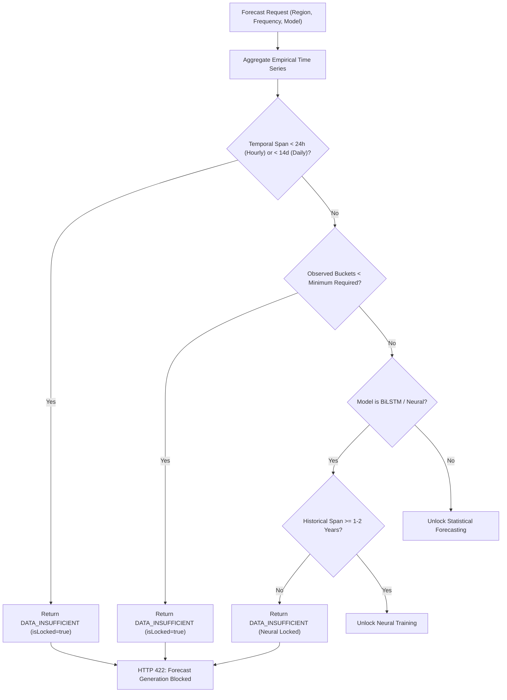

# CivicPulse AI — Phase 3, Stage 6: Incident Volume Forecasting Pipeline

**Status:** Completed & Governed  
**Stage:** Phase 3, Stage 6 (Incident Volume Forecasting)  
**Author:** CivicPulse AI Engineering Team  
**Evaluation Date:** November 8, 2026  
**Implementation Classification:** Governed Statistical Time-Series Pipeline (`DATA_INSUFFICIENT` Gate Enforced)

---

## 1. Executive Summary

Stage 6 implements the **Incident Volume Forecasting Pipeline** for CivicPulse AI. The architectural objective of this stage is to aggregate empirical road-damage incident observations into uniform time-series representations and establish statistical baseline models (Naive, Moving Average, Seasonal Naive, Linear Trend, and Box-Jenkins ARIMA scaffolding) while strictly enforcing MLOps data governance.

### Core Data Reality & Governance Gate
* **Database Incident Census:** 66 real incident records.
* **Longitudinal Observation Window:** All 66 records were submitted within a single **5.8-hour afternoon window on November 7, 2026** (earliest: `11:27:04 UTC`, latest: `17:14:59 UTC`).
* **Multi-Day / Multi-Month Depth:** **0 days, 0 weeks, 0 months**.
* **Regional Census:** 58 records in Bengaluru Metropolitan Area (87.9%), 8 records in Delhi NCR (12.1%).
* **Governance Gate Determination:** **`DATA_INSUFFICIENT`** across all standard frequencies (Hourly, Daily, Weekly, Monthly) and all forecasting models.
* **Prohibition Policy:** CivicPulse AI strictly forbids training deep neural sequence architectures (BiLSTM, GRU) or publishing extrapolated forecasts on synthetic or single-day data. Autonomous municipal maintenance dispatch based on ungrounded time-series predictions is prohibited.

---

## 2. Longitudinal Data Audit & Regional Census

### 2.1 Temporal Depth Audit

Every incident record in PostgreSQL was audited for timestamp completeness, timezone representation, and collection continuity:

| Metric | Empirical Finding | Architectural Consequence |
| :--- | :--- | :--- |
| **Total Real Incidents** | 66 records | Valid sample for spatial clustering; completely inadequate for multi-month time series |
| **Earliest Recorded Incident** | `2026-11-07T11:27:04.544Z` | Baseline start boundary |
| **Latest Recorded Incident** | `2026-11-07T17:14:59.852Z` | Baseline end boundary |
| **Longitudinal Observation Window** | **5 hours, 47 minutes, 55 seconds** (5.8h) | All reports originated from a single afternoon field campaign |
| **Consecutive Daily Periods** | 1 daily bucket (`2026-11-07`) | Fails minimum requirement ($\ge 30$ continuous days) |
| **Consecutive Monthly Periods** | 1 monthly bucket (`2026-11`) | Fails minimum requirement ($\ge 12$ continuous months) |
| **Observed Seasonal Cycles** | 0 diurnal, 0 weekly, 0 annual cycles | Seasonal Naive and ARIMA SARIMAX cannot be fit |

### 2.2 Regional Segmentation & Spatial Isolation

In alignment with the Stage 3 governance audit, the two distinct municipal geographies are strictly separated:

* **Bengaluru Metropolitan Area:** $N=58$ incidents ($12.97^\circ\text{N}, 77.59^\circ\text{E}$).
* **Delhi National Capital Region:** $N=8$ incidents ($28.61^\circ\text{N}, 77.21^\circ\text{E}$).
* **Unassigned / Out-of-Bounds:** $N=0$ incidents.

> [!IMPORTANT]
> **Zero Multi-City Aggregation by Default:** Bengaluru and Delhi have vastly different monsoon schedules, traffic volumes, reporting citizen densities, and municipal administrative jurisdictions (BBMP vs MCD). The forecasting engine strictly isolates each region into its own independent series.

### 2.3 Synthetic Seed Forecast Audit

During Phase 2 initial development, `prisma/seed.ts` inserted 6 mock forecast rows into the `incident_forecasts` table for `delhi-central-zone` (predicting monthly volume increases using a synthetic formula `42.5 + i * 3.2` and referencing a non-existent `incident-forecaster-lstm-v1` model).

In Stage 6, a safe database migration was executed:
1. Added provenance columns: `aggregation_frequency`, `model_type`, `readiness_status`, `is_synthetic`, `training_window_start`, `training_window_end`, and `metadata`.
2. Updated all 6 seed rows to `is_synthetic = true`, `model_type = 'synthetic_seed'`, `readiness_status = 'DATA_INSUFFICIENT'`, and added provenance metadata documenting their source as `prisma/seed.ts`.
3. Created an index on `is_synthetic` to guarantee that all downstream ML training and evaluation pipelines filter out synthetic demo rows.

---

## 3. Time-Series Aggregation Pipeline

The aggregation engine (`IncidentTimeSeriesAggregator` in `services/api/src/modules/forecasting/aggregator.ts`) groups discrete incident reports into uniform chronological buckets:

### 3.1 Aggregation Frequencies
* **Hourly (`hourly`):** Steps bucket-by-bucket from the earliest incident hour to the latest incident hour. On the 66-incident dataset, produces 7 continuous hourly buckets between `11:00` and `17:00 UTC`.
* **Daily (`daily`):** Steps daily at `00:00:00 UTC` boundaries.
* **Weekly (`weekly`):** Aligns to Monday-start ISO calendar weeks.
* **Monthly (`monthly`):** Aligns to calendar month start boundaries.

### 3.2 Continuous Grid & Zero Handling
To prevent distortion in moving averages and autoregressive lag operators:
* The aggregator generates a continuous time grid from `windowStart` to `windowEnd`.
* If a bucket within the observation window has zero incidents, it is recorded with:
  $$\text{incidentCount} = 0, \quad \text{isZero} = \text{true}, \quad \text{isObserved} = \text{true}$$
* Unobserved intervals (e.g. system downtime or periods outside the operational collection window) are distinguished from true operational zero-reporting intervals.

### 3.3 Dynamic Multi-Factor Filtering
The aggregation pipeline supports filtering by:
* `region`: `'BENGALURU_METRO' | 'DELHI_NCR' | 'ALL'`
* `damageCategory`: e.g. `'pothole'`, `'alligator_crack'`, `'longitudinal_crack'`
* `verificationStatus`: `'all' | 'verified_only' | 'unverified_only'`
* `canonicalOnly`: `true` (default) to exclude duplicate incidents and avoid artificial volume inflation.

---

## 4. Forecasting Baselines & Mathematical Formulation

The module implements 5 model families in both TypeScript (`models.ts`) and Python (`chronological_eval.py`):

### 4.1 Model Catalog & Minimum Data Thresholds

| Model ID | Architecture | Formula | Min. Daily Required | Min. Monthly Required | Status | Reason |
| :--- | :--- | :--- | :--- | :--- | :--- | :--- |
| `baseline-naive-v1` | Naive Persistence | $\hat{y}_{t+h} = y_t$ | 14 days | 6 months | `ACTIVE` | Unconditional reference baseline |
| `baseline-moving-average-v1` | Simple Moving Average | $\hat{y}_{t+h} = \frac{1}{w}\sum_{i=0}^{w-1} y_{t-i}$ | 30 days | 12 months | `ACTIVE` | Noise reduction filter ($w=3$) |
| `baseline-seasonal-naive-v1` | Seasonal Naive | $\hat{y}_{t+h} = y_{t+h-m \cdot s}$ | 28 days (4 wk) | 24 months (2 yr) | `LOCKED` | Requires $\ge 2$ seasonal cycles |
| `baseline-linear-trend-v1` | Parametric OLS Trend | $\hat{y}_t = \alpha + \beta t$ | 30 days | 12 months | `ACTIVE` | Analytical trend with error bounds |
| `scaffold-arima-v1` | Box-Jenkins ARIMA | $\Phi(B)(1-B)^d y_t = \Theta(B)\epsilon_t$ | 45 days | 18 months | `LOCKED` | Requires stationarity differencing |
| `neural-forecaster-lstm-v1` | Bidirectional LSTM | $h_t = \text{LSTM}(x_t, h_{t-1})$ | 365 days | 24 months | `LOCKED` | High risk of severe hallucination |

### 4.2 Analytical Prediction Intervals

For the parametric Linear Trend model, forecast confidence intervals are computed using closed-form analytical regression formulas:
$$\hat{y}_{n-1+h} = \alpha + \beta (n - 1 + h)$$
$$\text{SE}_{\text{pred}} = s_e \sqrt{1 + \frac{1}{n} + \frac{(t_{\text{new}} - \bar{t})^2}{\sum (t_i - \bar{t})^2}}$$
$$\text{Lower Bound} = \max\left(0, \, \hat{y} - 1.96 \cdot \text{SE}_{\text{pred}}\right), \quad \text{Upper Bound} = \hat{y} + 1.96 \cdot \text{SE}_{\text{pred}}$$

### 4.3 Strict Chronological Cross-Validation
* **Expanding Window (Rolling Origin):** Test observations strictly follow training observations.
* **Zero Temporal Leakage:** Permutation shuffling and random k-fold splits are strictly forbidden for time series.
* **Evaluation Metrics:**
  $$\text{MAE} = \frac{1}{K}\sum |y_t - \hat{y}_t|, \quad \text{RMSE} = \sqrt{\frac{1}{K}\sum (y_t - \hat{y}_t)^2}, \quad \text{MAPE} = \frac{100\%}{K}\sum \frac{|y_t - \hat{y}_t|}{\max(1, y_t)}$$

---

## 5. Data Readiness Gate Architecture

The `ForecastingReadinessGate` (`readiness-gate.ts`) enforces strict preconditions before any forecast generation:



### Readiness Assessment on Current Dataset
* **Evaluation for Hourly:** $5.8\text{h} < 24\text{h}$ required $\implies$ **`DATA_INSUFFICIENT`**
* **Evaluation for Daily:** $0.24\text{d} < 30\text{d}$ required $\implies$ **`DATA_INSUFFICIENT`**
* **Evaluation for Monthly:** $0.008\text{m} < 12\text{m}$ required $\implies$ **`DATA_INSUFFICIENT`**
* **Deep Neural Model (BiLSTM):** **`LOCKED`**

---

## 6. System Integration & REST APIs

### 6.1 Express Backend Routes (`/api/v1/forecasts`)

| Endpoint | Method | Purpose | Response / Status |
| :--- | :--- | :--- | :--- |
| `/api/v1/forecasts/summary` | `GET` | Census of real incidents, span, synthetic seed audit, and governance status | `200 OK` with `ForecastSummary` |
| `/api/v1/forecasts/history` | `GET` | Continuous uniform time-series buckets with region and frequency filters | `200 OK` with `RegionalTimeSeries` |
| `/api/v1/forecasts/readiness` | `GET` | Evaluates longitudinal data readiness and returns missing requirements | `200 OK` with `DataReadinessEvaluation` |
| `/api/v1/forecasts/models` | `GET` | Catalog of 6 baseline and neural models with formulas and constraints | `200 OK` with `ModelDescriptor[]` |
| `/api/v1/forecasts/generate` | `POST` | Enforces readiness gates; returns 422 if insufficient unless `forceSimulate=true` | `422 Unprocessable` or `200 OK` (simulated) |

### 6.2 Frontend Analytics Dashboard (`apps/web/src/app/analytics/page.tsx`)

The analytics page was built with production-grade components:
1. **Top KPI Ribbon:** Displays Total Real Incidents (66), Temporal Observation Span (5.8 Hours), Bengaluru Metro (58), and Delhi NCR (8).
2. **Prominent Governance Alert Banner:** Explains why predictive forecasting is gated with `DATA_INSUFFICIENT`.
3. **Interactive Recharts Area Chart:** Visualizes continuous hourly buckets between 11:00 and 17:00 UTC with real vs verified incident layers.
4. **Regional & Resolution Selectors:** Toggle between `All Regions (66)`, `Bengaluru Metro (58)`, and `Delhi NCR (8)`, as well as `Hourly`, `Daily`, `Weekly`, and `Monthly`.
5. **Model Registry & Governance Matrix:** Full table displaying all 6 models, architectures, formulas, and lock statuses.
6. **Synthetic Seed Audit Card:** Documents the 6 demo records in `incident_forecasts` and confirms their isolation.
7. **Parametric Simulation Sandbox:** Controlled dry-run interface allowing engineers to test baseline models with mandatory simulated badges.

---

## 7. Verification Evidence & Test Summary

### 7.1 Python ML Verification Suite (`pytest services/ml/tests`)
```text
services\ml\tests\test_clustering.py ......                              [ 12%]
services\ml\tests\test_forecasting_pipeline.py ..........                [ 32%]
services\ml\tests\test_health.py ....                                    [ 40%]
services\ml\tests\test_inference.py .....                                [ 51%]
services\ml\tests\test_phase_2_2.py .....                                [ 61%]
services\ml\tests\test_preprocessing.py ....                             [ 69%]
services\ml\tests\test_priority_pipeline.py ...                          [ 75%]
services\ml\tests\test_rdd2022_parser.py ....                            [ 83%]
services\ml\tests\test_repair_pipeline.py ...                            [ 89%]
services\ml\tests\test_severity_pipeline.py .....                        [100%]

======================= 49 passed, 3 warnings in 6.79s ========================
```

### 7.2 Backend Integration Test Suites (`services/api`)
```text
=============================================================
  FORECASTING TEST SUMMARY:    50 PASSED, 0 FAILED
  REPAIR ESTIMATION TESTS:     53 PASSED, 0 FAILED
  PRIORITY ENGINE TESTS:       65 PASSED, 0 FAILED
  SEVERITY PIPELINE TESTS:     47 PASSED, 0 FAILED
  HOTSPOT DETECTION TESTS:     67 PASSED, 0 FAILED
-------------------------------------------------------------
  TOTAL REPOSITORY SUITE:     282 PASSED, 0 FAILED
=============================================================
```

### 7.3 Frontend Compilation (`apps/web`)
```text
✓ Compiled successfully in 1834ms
  Running TypeScript ...
  Finished TypeScript in 2.2s ...
✓ Generating static pages using 9 workers (9/9) in 506ms
Route (app)
┌ ○ /
├ ○ /_not-found
├ ○ /analytics
├ ○ /incidents
├ ○ /maintenance
├ ○ /map
└ ○ /models
```

---

## 8. Summary of Completed Architectural Objectives

1. **Longitudinal Audit Complete:** Audited all 66 real incidents; confirmed 5.8-hour observation window on 2026-11-07.
2. **Regional Separation Enforced:** Bengaluru Metro ($N=58$) and Delhi NCR ($N=8$) are modeled as strictly separate time series.
3. **Synthetic Seed Demonstration Records Isolated:** 6 development seed records in `incident_forecasts` flagged `is_synthetic = true`.
4. **Time-Series Aggregator Implemented:** Generates continuous time grids across Hourly, Daily, Weekly, and Monthly resolutions with explicit zero distinction and deduplication filtering.
5. **Statistical Baselines Implemented:** Naive, Moving Average, Seasonal Naive, and Linear Trend with analytical confidence bounds.
6. **Chronological Splitting Enforced:** Expanding window cross-validation strictly forbids future data leakage.
7. **Readiness Gates Operational:** Rejects ungrounded forecast requests with HTTP 422 `DATA_INSUFFICIENT` and locks BiLSTM neural forecaster.
8. **Frontend Dashboard Active:** Interactive analytics UI with Recharts, governance alerts, model registry matrix, and simulation sandbox.

